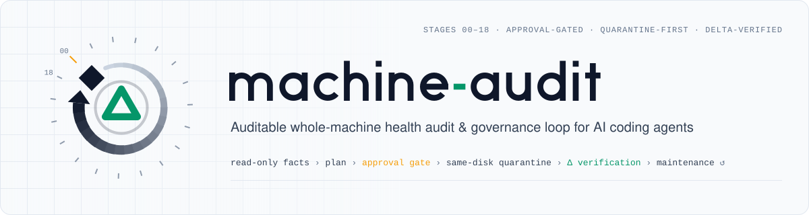

<p align="center">
  <picture>
    <source media="(prefers-color-scheme: dark)" srcset="docs/brand/banner-dark.svg">
    <source media="(prefers-color-scheme: light)" srcset="docs/brand/banner-light.svg">
    
  </picture>
</p>

<h1 align="center">machine-audit</h1>

<p align="center">
  <b>Audit before you act.</b> Auditable Whole-Machine Health Audit &amp; Governance Loop Skill for AI Coding Agents (Agent Skills Spec)<br>
  <b>先审计，再行动。</b>面向 AI 编码代理的可审计整机健康审查与治理循环技能包（Agent Skills 规范）
</p>

<p align="center">
  <a href="CHANGELOG.md"></a>
  <a href="assets/baseline.schema.json"></a>
  <a href="https://github.com/yunmin311/machine-audit/actions/workflows/ci.yml"></a>
  <a href="#6-compatibility-tests--known-limitations"></a>
  <a href="#3-the-19-audit-stages-0018--single-authoritative-stage-table"></a>
  <a href="references/domain-packs.md"></a>
  <a href="#4-installation--usage"></a>
  <a href="LICENSE"></a>
</p>

<p align="center">
  <a href="#中文文档"><b>中文文档</b></a>
  &nbsp;·&nbsp;
  <a href="#english-documentation"><b>English Documentation</b></a>
  &nbsp;·&nbsp;
  <a href="#5-execution-safety--honest-status">Safety Contract</a>
  &nbsp;·&nbsp;
  <a href="references/execution-safety.md">Security SOP</a>
  &nbsp;·&nbsp;
  <a href="CHANGELOG.md">Changelog</a>
</p>

---

## 中文文档

### 1. 这是什么 & 它解决什么问题

`machine-audit` 是一套面向 AI 编码代理（Claude Code / Codex / ZCode / Gemini CLI / Cursor 等）的**整机健康治理循环技能包**。它不是"一键删掉几个缓存目录"的清理脚本，而是一套**可审计、可回看、严格分级授权**的机器治理工作流：

```text
事实与风险（只读） → 具体方案 → 预览与批准门 → 前提检查 → 分批执行与逐批验证 → 复核 diff → 长期维护循环
```

| 常见痛点 | 本技能的工程回答 |
|---|---|
| **机器当前到底什么状态？** | 19 个阶段（`00–17` 系统面 + `18` 记忆与文档卫生）的只读诊断，每项检查强制标注六态覆盖状态（完整 / 抽样 / 失败 / 权限不足 / 未检查 / 不适用），禁止采集失败静默当作正常 |
| **哪些可清、哪些绝对碰不得？** | 基于事实链的 Git 备份健康评分（`project-doctor.ps1`）+ 重要资产地图（`asset-map`），按五要素证据结构分级输出，重要文件默认只指向、不动作 |
| **改坏或误删怎么办？** | 设计了「预览产物 + 同盘隔离区（两段式 rename）+ `operations.jsonl` 幂等日志 + 逆序回退」规程；**注意：执行器与回滚脚本当前尚未实现（见 §6 诚实声明）** |
| **如何避免越用越乱、下次再失忆？** | Kernel/Instance 彻底分离（通用审计知识在包内，本机参数/阈值/基线在 `overlay.yaml` 与 `baseline-YYYYMMDD.json`）、运行时领域探索、结构化基线机械门（`baseline-check.ps1`）与阶段 18 文档寿命治理 |

---

### 2. 设计原则与包结构

1. **只读诊断，方案先行，分级授权**
   诊断阶段对被查对象零写入；有副作用的检查（写盘测速、加载 shell profile 执行用户代码）必须单独标注并先取得用户同意。任何修改/删除动作必须落在经过**具体方案**与**批次批准门**授权的批次内。
2. **语义模型驱动（反特征码过拟合）**
   不以硬编码软件清单猜测机器用途，而是用**可叠加角色原语**（生产 / 消费 / 承载 / 连接 / 治理）定权重，用**10 个子系统**（存储 / 安全 / 网络 / 计算 / 媒体 / 开发 / 同步 / 凭据 / 服务 / 桌面环境）定检查，每项发现拆为**五元组**（资产 / 健康 / 一致性 / 暴露 / 可恢复）。跨 OS 只需替换命令投影，不改语义。
3. **Kernel / Instance 严格分离（包内零个人路径）**
   技能包本体只包含通用方法论、Schema、模板与无状态工具脚本；所有与特定机器绑定的路径、阈值、排除名单、噪音基线与资产清单全部写入用户的 `overlay.yaml` 与 `baseline-YYYYMMDD.json`。**包内出现个人绝对路径即视为 Bug。**
4. **运行时探索与五要素分级**
   `references/domain-packs.md` 提供 62 条领域线索作为探索起点；遇到未知软件时由 Agent 现场联网核验规范（附来源与日期）。每条发现必须具备五要素（观察事实 / 可能影响 / 证据充分度 / 严重程度 / 适用规则），禁止用恐吓性大词逼迫审批。
5. **四类记录分离与事实链评分**
   「本轮事实 / 已确认正常 / 待处理问题 / 有依据的例外」严格分表保存、禁止自动转化；问题关闭必须**重测原证据条件**，检查失败或对象离线不得记为已修好。Git 备份评分严格沿用事实链：`远端可达 → 目标分支精确匹配（-ceq 区分大小写）→ 实时 SHA 比对 → 统一身份判定（拦截自指远端与本地上游 `.`）`，不被活跃度或文档分抵消。

#### 包内结构与开箱组件

```text
machine-audit/
├── SKILL.md                        # Agent 技能入口规范（v1.0.0：何时用/五铁律/Tier路由表/输出形状）
├── README.md                       # 本说明文档（中英双语；含唯一阶段全览表与全包测试总数）
├── CHANGELOG.md                    # 版本变更记录
├── LICENSE                         # MIT 开源许可证
├── .gitignore                      # 排除本机私有产物（overlay/基线/报告）
├── .github/workflows/ci.yml        # Windows PowerShell 5.1 云端 CI（windows-latest 自动跑全套 147 条断言）
├── assets/                         # 配置、基线模板与声明式规则数据（Kernel/Instance 分离）
│   ├── overlay.template.yaml       # 本机参数模板（18 顶层键，字段定义以 conventions.md 为准）
│   ├── baseline.schema.json        # 基线 JSON Schema（v1.2，6 固定节 + meta + 可选 snapshots/network）
│   ├── baseline.template.md        # 基线人读视图模板（不一致时以 JSON 为准）
│   └── cleanup-rules.json          # 声明式清理候选规则库（18 条核心规则，强制 does_not_touch 边界）
├── references/                     # 全阶段操作规范与领域知识
│   ├── conventions.md              # 共通守则、PS5.1 陷阱规避与 §overlay 字段唯一权威表
│   ├── domain-packs.md             # 62 条领域线索种子库（紧凑表格索引）
│   ├── execution-safety.md         # 两段式执行、预览、回退与三栏删除验收规程
│   ├── memory-hygiene.md           # Stage 18 记忆与文档五层寿命治理
│   └── stage-00 ~ stage-17         # 系统面 18 个阶段细则（stage-00-bootstrap.md ~ stage-17-media.md）
├── scripts/                        # PS 5.1 兼容只读工具集（全部 UTF-8 BOM，公开包共 3 份）
│   ├── probe.ps1                   # 六合一只读探测工具（-Action env / space / docs / delta / rules / dupes）
│   ├── baseline-check.ps1          # 基线结构机械门（无 Test-Json 依赖，含 network 节与自定义阈值校验）
│   └── project-doctor.ps1          # Git 备份事实链巡检 v1.9（支持 -Baseline / -SaveBaseline）
├── tests/                          # 回归测试与负对照套件（PS 5.1 实跑，断言总数见首屏）
│   ├── test-backup-scoring.ps1     # doctor 备份评分反例与缓存/大小写回归
│   ├── test-baseline-schema.ps1    # 基线结构门与可选 network 节正反例回归
│   └── test-agent-helpers.ps1      # probe.ps1 六动作（env / space / docs / delta / rules / dupes）回归
└── docs/
    ├── brand/*.svg                 # 双主题矢量品牌标与 README Banner（明暗自动切换）
    └── design/execution-safety.md  # 预览、隔离区、操作日志与空间增量完整设计书
```

| 脚本 | 核心能力 | 面向 Agent 的防踩坑特性 |
|---|---|---|
| `scripts/probe.ps1` | 六合一只读探测（`-Action env \| space \| docs \| delta \| rules \| dupes`）：环境/卷与 MFT 工具探测、单遍目录与 3×3 矩阵/Top-50 实占/未归账对账（支持筛选与 `-StreamOut`/`-Resume`）、规则库只读匹配、四级漏斗查重（含硬链接分离）、Markdown 膨胀扫描、删除三栏与偏差核对 | `-Action env` 默认不扫盘；`-Action space` 筛选参数不扭曲目录/矩阵总账；`-Action dupes` 跳过 0B/重解析点/云占位且按 `GetFileInformationByHandle` 排除 NTFS 硬链接防零释放误删；`-Action delta` 单引号保护 `'$Recycle.Bin'` |
| `scripts/baseline-check.ps1` | 机械校验基线 JSON 必填六节、带时区时间戳、数值型 `free_pct`、红线自洽、`owner_note`、`scan_status` 与可选 `network` 链路基线 | 不依赖 PS 6.1+ `Test-Json`；拦截 `files=0 && bytes>0`、`scan_status=failed` 与 `loss_pct` 越界；支持 `-WarnPct`/`-CritPct` |
| `scripts/project-doctor.ps1` | 扫描项目根目录下的 Git 仓库与非 Git 目录，按备份事实链输出 A/B/C/D/X 分级表、隐私检查与跨轮基线 diff | 15 秒进程级 `ls-remote` 超时；自指远端五种形态统一身份拦截；`-Baseline` 无快照时显式报「无基线，本轮不判趋势」；`-SaveBaseline` 仅补 `snapshots.doctor` |

---

### 3. 19 个审计阶段全览（唯一阶段表，改这里）

> 默认分层执行策略：**Tier 1 必查（6）**=`00/02/04/07/11/13` · **Tier 2 按角色（7）**=`05/06/09/10/15/16/17` · **Tier 3 按信号触发（6）**=`01/03/08/12/14/18`（`quick` 跑 Tier 1，`full` 跑 Tier 1+2）。

| # | 阶段（层级） | 核心检查内容 | 对应文档 |
|---|---|---|---|
| 00 | Bootstrap（T1） | 环境与权限探测、角色/领域识别、生成 `overlay.yaml` 与首轮基线（`probe.ps1 -Action env\|space`） | `references/stage-00-bootstrap.md` |
| 01 | 硬件与固件（T3） | 硬件型号、内存频率差值、磁盘固件与驱动过时检测 | `references/stage-01-hardware.md` |
| 02 | 磁盘空间账目（T1） | 红线判定、规则匹配（`assets/cleanup-rules.json` 18 条 + `does_not_touch`）、3×3 矩阵、筛选 Top-50 实占、`-Action dupes` 四级漏斗查重与 `-StreamOut`/`-Resume` | `references/stage-02-disk.md` |
| 03 | 磁盘规则符合度（T3） | 按可选 `rules_file` 校验前缀/冻结名单/快照超期；无规则时仅做通用命名观察 | `references/stage-03-rules.md` |
| 04 | 开发环境（T1） | 运行时版本矩阵、PATH 失效检查、Git/代理身份、凭据台账（五要素）与 **CLI 登录三态体检** | `references/stage-04-dev-env.md` |
| 05 | 虚拟化（T2） | WSL 登记与注册表一致性、VBox/Hyper-V/模拟器实体与 vhdx 体量 | `references/stage-05-virtualization.md` |
| 06 | 软件服务自启 diff（T2） | 卸载表、系统服务、自启项与计划任务相对基线的变化 | `references/stage-06-software-diff.md` |
| 07 | 安全态势（T1） | Defender/AV 防护状态、防火墙暴露面、监听端口进程溯源、SMB 共享与远程面 | `references/stage-07-security.md` |
| 08 | 持久化与劫持（T3） | IFEO、WMI 订阅、浏览器策略、PAC、第三方根证书与 AppInit_DLLs（条件化定级） | `references/stage-08-persistence.md` |
| 09 | 事件日志四查（T2） | System 7 天错误、应用崩溃/.NET 堆栈、PSCore、与 `overlay.noise` 基线 diff | `references/stage-09-logs.md` |
| 10 | Agent 与 CLI 盘点（T2） | AI Agent 数据目录矩阵（`agent_dirs_extra`）、凭据与同步通道交叉、沙箱账户核对 | `references/stage-10-agents.md` |
| 11 | 备份合规（T1） | Git 同步事实链（`project-doctor.ps1`）+ 核心资产 3-2-1 评估与还原点检查 | `references/stage-11-backup.md` |
| 12 | 终端健康（T3） | `pwsh`/Windows Terminal/cmd/Git Bash/VS Code 终端配置与启动健壮性 | `references/stage-12-terminals.md` |
| 13 | 报告与 diff（T1） | 两段式报告（含人话段占比条形图与 `预估 vs 实际` 闭环）、覆盖状态表、四类记录、关系链检查与双写 SHA256 校验 | `references/stage-13-report.md` |
| 14 | 性能基准（T3 · 可选） | 只读基线采样；写盘压测默认关闭，须单独授权 | `references/stage-14-benchmark.md` |
| 15 | 残留净化复查（T2） | 双桌面死快捷方式、死服务、死卸载/自启、空壳/孤儿目录、拒绝型 ACL、零使用服务四重证据 | `references/stage-15-residue.md` |
| 16 | 网络 / VPN / 远端（T2） | 代理栈、组网安全位、WSL NAT/mirrored、手写配置（`configs`）漂移与 **§8 三目标链路基线** | `references/stage-16-network.md` |
| 17 | 媒体 / 相册治理（T2） | 原片完整性、3-2-1 冷备、catalog 代数、重复副本与检索层选型 | `references/stage-17-media.md` |
| 18 | 记忆与文档卫生（T3） | L0–L4 五层寿命模型、15 轮/200 份硬触发、先蒸馏后退役、`probe.ps1 -Action docs` 扫描 | `references/memory-hygiene.md` |

---

### 4. 安装与使用

#### 4.1 安装（跨工具标准技能目录）

```text
~/.agents/skills/machine-audit/
```

从公开仓库（`https://github.com/yunmin311/machine-audit`）克隆或复制发布包至上述目录（或所用 Agent 的 skills 目录）即可识别。**维护铁律**：修改只在源仓库进行，安装位仅作部署副本同步覆盖，禁止双头编辑。

#### 4.2 标准工作流命令（Windows PowerShell 5.1+）

```powershell
# 1. 首跑建档：采集环境与卷账目（schema 1.2），并枚举目标目录写入 top_dirs
powershell.exe -NoProfile -ExecutionPolicy Bypass -Command `
  "& '.\scripts\probe.ps1' -Action env -OutDir 'D:\AuditOut' -WriteMarkdown"
powershell.exe -NoProfile -ExecutionPolicy Bypass -Command `
  "& '.\scripts\probe.ps1' -Action space -Roots @('D:\MyProjects') -Baseline 'D:\AuditOut\baseline-20261117.json' -WriteMarkdown"

# 1b. 声明式清理候选只读匹配（返回估算体量、原生建议命令与 does_not_touch 边界）
powershell.exe -NoProfile -ExecutionPolicy Bypass -File .\scripts\probe.ps1 -Action rules

# 1c. 四级漏斗只读查重（跳过 0 字节/云占位，区分 NTFS 硬链接）+ 按条件筛大文件 / 流式续扫
powershell.exe -NoProfile -ExecutionPolicy Bypass -Command `
  "& '.\scripts\probe.ps1' -Action dupes -Roots @('D:\Downloads') -MinSizeMB 10"
powershell.exe -NoProfile -ExecutionPolicy Bypass -Command `
  "& '.\scripts\probe.ps1' -Action space -Roots @('D:\MyProjects') -StreamOut 'D:\AuditOut\space.jsonl' -Resume"

# 2. 基线结构机械门（自定义阈值时传入 -WarnPct / -CritPct）
powershell.exe -NoProfile -ExecutionPolicy Bypass -File .\scripts\baseline-check.ps1 `
  -Path D:\AuditOut\baseline-20261117.json -WarnPct 15 -CritPct 10

# 3. 写入首轮 Git 快照到同一份基线（避免次轮 -Baseline 报"无基线"）
powershell.exe -NoProfile -ExecutionPolicy Bypass -Command `
  "& '.\scripts\project-doctor.ps1' -Roots @('D:\MyProjects','E:\Code') -OutDir 'D:\AuditOut' -SaveBaseline 'D:\AuditOut\baseline-20261117.json'"
powershell.exe -NoProfile -ExecutionPolicy Bypass -File .\scripts\baseline-check.ps1 -Path D:\AuditOut\baseline-20261117.json

# 4. 后续复核：带趋势 diff 运行 project-doctor
powershell.exe -NoProfile -ExecutionPolicy Bypass -Command `
  "& '.\scripts\project-doctor.ps1' -Roots @('D:\MyProjects','E:\Code') -OutDir 'D:\AuditOut' -Baseline 'D:\AuditOut\baseline-20261117.json' -SaveBaseline 'D:\AuditOut\baseline-20261124.json'"

# 5. 文档卫生巡检（Stage 18）
powershell.exe -NoProfile -ExecutionPolicy Bypass -Command `
  "& '.\scripts\probe.ps1' -Action docs -Roots @('D:\MyProjects') -OutFile 'D:\AuditOut\hygiene.md'"
```

> **Agent 防踩坑提示**：
> - **PowerShell `-File` 数组参数陷阱**：在 `powershell.exe -File script.ps1 -Roots "A","B"` 模式下，只有第一个值 `"A"` 会绑定进 `[string[]]$Roots`，第二个值会被静默丢弃！传多个根目录必须使用 `-Command "& '...' -Roots @('A','B')"`。
> - **禁止 `System.IO.EnumerationOptions`**：该类型在 PowerShell 5.1（.NET 4.x）不存在；枚举目录请使用 `scripts/probe.ps1 -Action space` 或 `references/stage-02-disk.md` 的 `EnumerateFileSystemInfos` 2 参实现。
> - **自然语言触发**：对 Agent 说「整机体检」「跑一遍 machine-audit」「电脑变卡了」「删这些之前先检查」「按计划清理」「复查 diff」即可按 `SKILL.md` 自动进入对应模式（`bootstrap` / `quick` / `full` / `execute` / `maintain`）。

---

### 5. 执行安全（含"尚未脚本化"显式声明）

```text
批准门之前：tree-before / tree-after / asset-map / rollback-manifest
            （tree-after = 改完之后的样子；asset-map = 重要文件位置图）
执行时：    删除类一律先移同盘隔离区（不真删，机器照常使用 = 真实预览）
            每动作先写 operations.jsonl（幂等重放、中断恢复、防重复操作）
宽限期：    隔离区保留 14 天 → 期满且你再次确认 → 才真正清空
            （以上为设计规程约束；执行器脚本与验收证据见 v0.9 路线图）
回退：      rollback 读日志逆序回放，每步校验哈希；回滚失败 ≠ 数据丢失
```

> **该机制尚未脚本化（`invoke-plan.ps1` / `rollback.ps1` 等执行器尚未实现）：以上为设计中的调用约定；当前需按 `references/execution-safety.md` 规程手工执行。**

- **已实现并有自动化验证的机制**：
  - 删除三栏空间增量验收工具（`scripts/probe.ps1 -Action delta`）：在清理批前后采集并输出「逻辑释放 X GB / 实测释放 Y GB / 回收站 Z GB」，防止文件移入 `$Recycle.Bin` 后原路径消失造成的"假成功"。
  - 完整设计规范见 [`docs/design/execution-safety.md`](docs/design/execution-safety.md) 与 [`references/execution-safety.md`](references/execution-safety.md)。
- **尚未实现的自动化执行器（诚实声明）**：
  - `scripts/invoke-plan.ps1`（计划消费、隔离区移动、`operations.jsonl` 自动写回与指纹校验）**尚未实现**。
  - `scripts/rollback.ps1`（逆序回放与哈希校验回滚）**尚未实现**。
  - L2 树状预览生成器（`preview/<runid>/tree-before.md`、`tree-after.md`、`operations-preview.jsonl`）与 L3 隔离区 14 天宽限期自动到期管理**尚未实现**。

---

### 6. 兼容性、测试与已知限制

#### 6.1 平台兼容性

| 平台 / 场景 | 状态与说明 |
|---|---|
| **Windows 10 / 11（PowerShell 5.1+）** | ✅ 当前主线平台；全包 `.ps1` 以 UTF-8 BOM + PS 5.1 为最低公分母验证 |
| **杀软 / CLM / 云占位 / 乱码 / 超长路径** | 有显式降级、跳过属性（`ReparsePoint` / `RecallOnDataAccess`）与受限声明，无静默吞错 |
| **macOS / Linux** | 语义模型已跨平台通用；命令投影为 `v1.0` 路线 |

#### 6.2 自动化测试（PS 5.1 实跑，断言总数见首屏）

```powershell
powershell.exe -NoProfile -ExecutionPolicy Bypass -File tests\test-backup-scoring.ps1
powershell.exe -NoProfile -ExecutionPolicy Bypass -File tests\test-baseline-schema.ps1
powershell.exe -NoProfile -ExecutionPolicy Bypass -File tests\test-agent-helpers.ps1
```

- `test-backup-scoring.ps1`：覆盖各类对抗性边界反例（无远端 / 远端已删 / `.gitignore` 唯一资产 / 远端回退 / 空远端 / 无上游 / 索引损坏 / `Main/main` 大小写并存 / 自指远端五种形态 / 本地 `.` 上游 / 陈旧缓存不降级 / 顶层与嵌套 `ReparsePoint` 跳过）+ 健康对照 + 报告完整性 + 阈值自检；`try/finally` 自清理 `%TEMP%` 并断言无残留。
- `test-baseline-schema.ps1`：专测结构门自身——正例通过（含可选 `network` 节）；`free_pct` 字符串、空 `owner_note`、缺节、无毫秒 `run_id`、`redline` 矛盾、非管理员无受限登记、`sampled=false && files=0 && bytes>0`、`scan_status=failed`、`partial && !sampled`、`-CritPct 20` 自定义阈值、`network.targets` 为空、`network` 越界指标与缺失文件，全部必须 FAIL 且精准定位字段。
- `test-agent-helpers.ps1`：全面覆盖 `scripts/probe.ps1` 六动作——`-Action env`（schema 1.2 + `fast_scanners` + 虚拟共享盘标记 + MD 视图）、`-Action space`（根目录直属文件入矩阵与 Top-N + 1MB + 空目录 + junction 跳过 + `MaxFilesPerDir` 截断标 `partial` + 缺失 `-Roots/-TopDirs` 标 `failed` 被门禁拒绝 + 3×3 年龄矩阵 + 物理占盘与稀疏标志 + 子树/卷对账 + `§SpaceBreakdown` + `-MinSizeMB/-MinAgeDays/-IncludeExt` 筛选 + 无损 `-StreamOut`/`-Resume` 与宽条件自动重扫）、`-Action rules`（18 条规则 invariants + `%ENV%` 展开 + 多路径 `partial` `path_details` + 稀疏实占）、`-Action dupes`（四级漏斗短接 + NTFS 硬链接归簇 + 外部硬链接 `recommended_keep_path` + 0 字节/云占位与重叠根保护）、`-Action docs`（只读去重阈值扫描）、`-Action delta`（Snapshot、`QuarantineMode`、回收站负对照、实增正对照、`estimated_vs_actual`、非法盘符）以及第 9 节 Torture 脏边界集（`[v1] $中文` 通配符路径与 `-OutDir`、`Offline` 云盘占位符零水合、`MAX_PATH > 260` `\\?\` 兜底、缺失 `-Roots` 拒止、Windows 8.3 短路径规范化）；全部 3 套测试同时由 `.github/workflows/ci.yml` 在 GitHub Actions `windows-latest` 上自动触发回归。

#### 6.3 已知限制与路线图

- **当前已知限制**：`project-doctor.ps1` 全局 `SilentlyContinue` 的错误吞噬限制已如实声明；`ls-remote` 采用 15s 进程级超时；两段式执行器（`invoke-plan.ps1` / `rollback.ps1`）、L2 预览生成器与宽限期管理**尚未脚本化**（已顺延至 `v1.1` 路线图）；`v1.0.0` 正式支持 Windows（macOS/Linux 命令投影与一机多系统协同规则列为 `v2.0` 路线图）；除阶段 00/02/11/13/18 配套脚本外，其余系统面阶段以规范引导人工/Agent 采样为主。
- **v1.0.0（当前）**：Windows 生产正式版定版——通过外部隔离沙盒 `E2E-1 ~ E2E-7`（含两轮完整趋势 diff、真实 `fsutil` 稀疏文件物理/逻辑比对、文档行数与年龄触发、多副本查重截断、自定义 `-CritPct` 与 `network` 门禁、镜像 SHA256 双写校验及 `147/147` 回归全绿）与离线 8 场景盲测全通；对齐 `project-doctor.ps1` 第 24 行注释术语与 `stage-13-report.md`（`新出现/已消失/改善/恶化/持平`）；`README.md` 顶部升级为居中 Shields.io + 实时 CI 状态徽章。
- **v0.9.7**：依据 GitHub Actions `windows-latest`（`%TEMP%` 含 `RUNNER~1` 8.3 短路径）真实 CI 日志定位并修复长短路径混用缺陷——`probe.ps1` 新增 `Resolve-WinCanonicalPath` 将 `-Roots`/`-TopDirs`/`-StreamOut`/`-Resume` 与查重根目录统一规范化为完整路径，并修正 `test-agent-helpers.ps1` `$WorkRoot` 初始化及新增 `Torture-9e`（全套 `147` 条断言）。
- **v0.9.6**：修复黑盒边界压力测试 Case 7 暴露的口径不一致——`probe.ps1 -Action space` 对缺失/离线 `-Roots` 同步置 `meta.scan_status=failed` 并记入 `top_dirs`（使 `baseline-check.ps1` 正确拒绝），根目录直属文件读取异常显式记入 `partial`/restrictions；`-OutDir` 目录创建全面切换 `[IO.Directory]::CreateDirectory`，并新增 `Torture-9d`。
- **v0.9.5**：依据 Windows / NTFS / PowerShell 5.1 公开高频陷阱完成轻量加固——`project-doctor.ps1` `-Roots`/`-OutDir` 与报告写入全量切换 `-LiteralPath` 及 `[IO.Directory]::CreateDirectory`，消除 `[v1]` 通配符误解析崩溃；`probe.ps1` 新增 `Get-WinLongSafePath` `\\?\` 兜底覆盖 `MAX_PATH > 260` 目录遍历与哈希读取；`tests/test-agent-helpers.ps1` 新增第 9 节 Torture 脏边界测试集；新增 `.github/workflows/ci.yml` 云端 `windows-latest` 自动回归，公开脚本仍维持 `3` 个。
- **v0.9.4**：依据实机全流程试跑与对抗沙盒实测修复 7 处边缘缺陷——`probe -Action space` 将根目录直属文件纳入矩阵与 Top-N、`StreamOut/Resume` 无损携带每目录分桶与大文件并在条件放宽时自动绕过陈旧流缓存重扫；`-Action rules` 支持分路径 `partial`/`path_details` 与稀疏 `estimated_allocated_bytes`；`docs` 重叠父子根去重；`dupes` 外部硬链接精准保底推荐；`project-doctor.ps1` 跳过 `ReparsePoint`；强化 `Everything`/虚拟共享盘探测及跨 WSL2 调用指南。
- **v0.9.3**：补充面向多样机器生态的 Batch 2 只读模块——新增 `probe.ps1 -Action dupes` 四级漏斗查重（含 `GetFileInformationByHandle` NTFS 硬链接识别与云占位保护）、`-MinSizeMB/-MinAgeDays/-IncludeExt/-ExcludeExt` 结构化筛选、`-StreamOut/-Resume` 流式断点续扫、`snapshots.fast_scanners`（Everything `es.exe`/WizTree）只读探测，并将 `assets/cleanup-rules.json` 扩至 18 条规则。
- **v0.9.2**：新增声明式清理规则数据 `assets/cleanup-rules.json`、`-Action rules`、单遍 `3×3` 年龄×体量矩阵 / `GetCompressedFileSizeW` Top-50 / `<Unknown>` 对账、报告条形图规范与 `预估 vs 实际回收` 偏差闭环。
- **v0.9.1**：`SKILL.md` 路由表标题措辞修正（明确 README 阶段表仅供人读，agent 不必加载）。无功能变更。
- **v0.9.0**：`SKILL.md` 改为 Tier 1/2/3 分层与 17 项信号路由；剥离重复清单；`stage-02`/`15`/`execution-safety` 完成故事与判据分离；公开脚本 5 合 3（统一 `scripts/probe.ps1`）；新增 `stage-04` CLI 登录体检与 `stage-16 §8` 链路基线（`schema 1.2` + `network` 节校验）。
- **v1.1 路线图**：执行器脚本化（`invoke-plan.ps1` / `rollback.ps1`，当前尚未实现）、L2 预览生成器、隔离区宽限期自动化管理、其余系统面阶段的最小断言补齐。
- **v2.0 路线图**：macOS / Linux 命令投影（`probe.sh` 等）与**一机多系统 / 双启动场景**（跨 OS 共享盘、EFI 分区只读保护、Windows Fast Startup 休眠写锁防破坏）治理规范。

---

### 7. 许可（License）

本项目采用 [MIT License](LICENSE) 开源许可。

---

## English Documentation

### 1. What It Is & Problems It Solves

`machine-audit` is an **auditable whole-machine health audit and governance loop skill** built for AI coding agents (Claude Code, Codex, ZCode, Gemini CLI, Cursor, etc.) following the Agent Skills specification. Rather than acting as a blind one-click cleaner, it enforces a verifiable engineering lifecycle:

```text
Facts & Risks (Read-Only) → Concrete Plan → Preview & Approval Gate → Precondition Check → Batched Execution & Per-Batch Verification → Re-check Diff → Maintenance Loop
```

| Core Question | How `machine-audit` Answers It |
|---|---|
| **What is the machine's true state?** | 19 stages (`00–17` OS/subsystem checks + `18` memory & document hygiene) with mandatory six-state coverage reporting (`full / sampled / failed / permission-denied / unchecked / n/a`)—collection failures are never silently reported as healthy |
| **What can be cleaned vs. untouched?** | Evidence-chain Git backup scoring (`project-doctor.ps1`) + an explicit `asset-map` for irreplaceable files, graded via a 5-field structure without executing unapproved changes |
| **What if a change breaks something?** | Specifies a two-phase execution model (preview artifacts, same-disk quarantine rename, `operations.jsonl` idempotent journal, reverse hash-verified rollback). **Note: automated executor and rollback scripts are not yet implemented (see Section 5)** |
| **How to avoid recurring entropy?** | Strict Kernel/Instance separation (`overlay.yaml` + `baseline-YYYYMMDD.json`), runtime domain exploration, mechanical baseline schema gating (`baseline-check.ps1`), and Stage 18 Markdown lifecycle management |

---

### 2. Design Principles & Package Layout

1. **Read-Only Diagnosis, Plan-First Approval**
   Diagnostic phases perform zero writes on audited targets. Side-effecting checks (disk write benchmarks, sourcing shell profiles) require explicit labeling and user consent. Every destructive or mutating action must belong to an approved batch in a concrete plan.
2. **Semantic Model over Static Signatures**
   Machines are modeled as composable **role primitives** (`production / consume / host / connect / govern`) driving subsystem weights across **10 subsystems** (`storage / security / network / compute / media / dev / sync / credentials / services / desktop`), with each finding decomposed into a **5-tuple** (`asset / health / consistency / exposure / recoverability`). Porting to another OS only swaps command projections, never semantics.
3. **Strict Kernel / Instance Separation**
   The package holds only generic audit knowledge, schemas, templates, and stateless helpers. Machine-specific paths, thresholds, exclusions, noise baselines, and asset inventories live exclusively in per-machine `overlay.yaml` and `baseline-*.json` files. **Any personal absolute path inside the package is treated as a bug.**
4. **Runtime Exploration & 5-Element Grading**
   `references/domain-packs.md` seeds 62 domain cues as exploration starting points; unfamiliar software triggers live web verification with cited sources and dates. Every finding records five elements (observed fact / potential impact / evidence strength / severity / applicable rule).
5. **Four Separated Record Types & Backup Fact Chain**
   *Current observations*, *verified normal*, *open issues*, and *justified exceptions* are stored separately without silent promotion. Closing an issue requires re-testing the original evidence condition. Git backup grading follows a strict fact chain (`reachable remote → exact case-sensitive target ref match via -ceq → live SHA comparison → unified repository identity check blocking self-referential remotes and local "." upstreams`), never offset by commit activity or README presence.

```text
machine-audit/
├── SKILL.md                        # Agent skill specification (v1.0.0: when to use, 5 iron rules, tiered routing, output shape)
├── README.md                       # Bilingual documentation (Chinese / English; single stage table & total assertion count)
├── CHANGELOG.md                    # Release history
├── LICENSE                         # MIT License
├── .gitignore                      # Ignores per-machine private artifacts (overlay/baseline/reports)
├── .github/workflows/ci.yml        # GitHub Actions windows-latest CI (automatically runs all 147 PS 5.1 assertions)
├── assets/                         # Authoritative templates, JSON Schema & declarative rules (Kernel/Instance split)
│   ├── overlay.template.yaml       # Per-machine parameter template (18 top-level keys; semantics in conventions.md)
│   ├── baseline.schema.json        # Baseline JSON Schema (v1.2: 6 fixed sections + meta + optional snapshots/network)
│   ├── baseline.template.md        # Human-readable baseline view (JSON is authoritative on mismatch)
│   └── cleanup-rules.json          # Declarative cleanup rule catalog (18 core rules with mandatory does_not_touch bounds)
├── references/                     # Stage SOPs & domain knowledge
│   ├── conventions.md              # Cross-stage guardrails, PS 5.1 traps & authoritative §overlay field table
│   ├── domain-packs.md             # 62 domain cue seed packs (compact table index)
│   ├── execution-safety.md         # Two-phase execution, preview, rollback & 3-column deletion SOP
│   ├── memory-hygiene.md           # Stage 18 5-tier document lifecycle model
│   └── stage-00 ~ stage-17         # 18 system audit stage specifications (stage-00-bootstrap.md ~ stage-17-media.md)
├── scripts/                        # PS 5.1-compatible read-only helpers (UTF-8 BOM, 3 public scripts)
│   ├── probe.ps1                   # Unified 6-in-1 read-only helper (-Action env / space / docs / delta / rules / dupes)
│   ├── baseline-check.ps1          # Mechanical baseline gate (PS 5.1 safe, no Test-Json, network + custom thresholds)
│   └── project-doctor.ps1          # Git backup fact-chain auditor v1.9 (-Baseline / -SaveBaseline)
├── tests/                          # PS 5.1 regression & negative-control suites (total assertions in header banner)
│   ├── test-backup-scoring.ps1     # Adversarial backup-scoring counterexamples, cache invariance & case collision
│   ├── test-baseline-schema.ps1    # Mechanical gate positive/negative controls (incl. optional network section)
│   └── test-agent-helpers.ps1      # probe.ps1 six-action verification (env / space / docs / delta / rules / dupes)
└── docs/
    ├── brand/*.svg                 # Dual-theme vector logo mark & README banners (auto dark/light)
    └── design/execution-safety.md  # Detailed design spec for previews, quarantine, journal & space accounting
```

| Script | Capabilities | Agent-Safety Guardrails |
|---|---|---|
| `scripts/probe.ps1` | Unified read-only probe (`-Action env \| space \| docs \| delta \| rules \| dupes`): env/MFT scanner discovery, single-pass dir sizing + 3×3 matrix + Top-50 physical bytes + `<Unknown>` reconciliation (structured filters & `-StreamOut`/`-Resume`), declarative rule matching, 4-stage duplicate funnel, Markdown bloat scan & 3-column delta + estimate comparison | `-Action env` skips disk walks by default; `-Action space` candidate filters leave directory & matrix accounting exact; `-Action dupes` skips 0B/reparse/cloud placeholders and separates NTFS hardlinks via `GetFileInformationByHandle`; `-Action rules` emits `does_not_touch`; `-Action delta` single-quotes `'$Recycle.Bin'` |
| `scripts/baseline-check.ps1` | Validates required 6 sections, timezone-offset ISO timestamps, numeric `free_pct`, redline consistency, `owner_note`, `scan_status` & optional `network` baseline | No PS 6.1+ `Test-Json` dependency; rejects `sampled=false && files=0 && bytes>0`, `scan_status="failed"` & out-of-range `loss_pct`; supports `-WarnPct` / `-CritPct` |
| `scripts/project-doctor.ps1` | Audits Git repos and non-Git folders across target roots with A/B/C/D/X grading, email/secret checks, and baseline diffs | 15s process-level `ls-remote` timeout; detects 5 self-referential remote patterns; outputs explicit "no baseline" when snapshots are absent; `-SaveBaseline` updates only `snapshots.doctor` |

---

### 3. The 19 Audit Stages (00–18) — Single Authoritative Stage Table

> Default tiered execution scope: **Tier 1 Always (6)**=`00/02/04/07/11/13` · **Tier 2 Role-Based (7)**=`05/06/09/10/15/16/17` · **Tier 3 Signal-Triggered (6)**=`01/03/08/12/14/18` (`quick`=Tier 1, `full`=Tier 1+2).

| # | Stage (Tier) | Scope | Reference |
|---|---|---|---|
| 00 | Bootstrap (T1) | Environment & privilege probe, role/domain detection, `overlay.yaml` & initial baseline (`probe.ps1 -Action env\|space`) | `references/stage-00-bootstrap.md` |
| 01 | Hardware & Firmware (T3) | Device model, RAM speed mismatch, disk firmware & outdated driver checks | `references/stage-01-hardware.md` |
| 02 | Disk Space Accounting (T1) | Redline checks, rules (`assets/cleanup-rules.json` 18 rules + `does_not_touch`), 3×3 matrix, filtered Top-50 physical bytes, `-Action dupes` 4-stage funnel & `-StreamOut`/`-Resume` | `references/stage-02-disk.md` |
| 03 | Disk Rule Compliance (T3) | Validates naming/structure/snapshot retention against optional `rules_file`; advisory naming checks when unconfigured | `references/stage-03-rules.md` |
| 04 | Dev Environment (T1) | Runtime matrix, PATH health, Git/proxy identity, credential inventory (5-element grading) & **3-state CLI login check** | `references/stage-04-dev-env.md` |
| 05 | Virtualization (T2) | WSL registry vs `wsl -l -v` parity, VBox/Hyper-V/emulators & `.vhdx` footprint | `references/stage-05-virtualization.md` |
| 06 | Software & Autorun Diff (T2) | Uninstall entries, services, startup items & scheduled tasks diffed against baseline | `references/stage-06-software-diff.md` |
| 07 | Security Posture (T1) | Defender/AV status, firewall exposure, listening port process attribution, SMB shares & remote surfaces | `references/stage-07-security.md` |
| 08 | Persistence & Hijacking (T3) | IFEO, WMI subscriptions, browser policies, PAC, third-party root CAs & AppInit_DLLs (conditional grading) | `references/stage-08-persistence.md` |
| 09 | Event Log 4-Way Check (T2) | 7-day System errors, App crashes + `.NET Runtime` stacks, PSCore, diffed against `overlay.noise` | `references/stage-09-logs.md` |
| 10 | Agent & CLI Inventory (T2) | AI agent data footprint (`agent_dirs_extra`), credential-vs-sync overlap checks & sandbox accounts | `references/stage-10-agents.md` |
| 11 | Backup Compliance (T1) | Git sync fact chain (`project-doctor.ps1`) + 3-2-1 evaluation for `overlay.assets` & restore points | `references/stage-11-backup.md` |
| 12 | Terminal Health (T3) | `pwsh`, Windows Terminal, `cmd`, Git Bash & VS Code integrated terminal diagnostics | `references/stage-12-terminals.md` |
| 13 | Report & Baseline Diff (T1) | Two-part report (with plain-language share bars & estimated-vs-actual loop), coverage matrix, 4-class records, cross-system chains & SHA256 mirror verification | `references/stage-13-report.md` |
| 14 | Benchmarks (T3 · Optional) | Read-only baseline metrics; write benchmarks disabled unless explicitly authorized | `references/stage-14-benchmark.md` |
| 15 | Residue Audit (T2) | Dual-Desktop dead shortcuts, dead services/uninstall/tasks, orphan/empty dirs, Deny ACLs & 4-evidence zero-use services | `references/stage-15-residue.md` |
| 16 | Network / VPN / Remotes (T2) | Proxy stack, mesh/VPN security bits, WSL NAT/mirrored, `overlay.configs` drift & **§8 3-target link baseline** | `references/stage-16-network.md` |
| 17 | Media & Photo Governance (T2) | RAW integrity, 3-2-1 cold backup, catalog generation tracking, duplicate copies & search layer sizing | `references/stage-17-media.md` |
| 18 | Memory & Doc Hygiene (T3) | 5-tier document lifespan (`L0–L4`), 15-turn / >200-file hard triggers, distill-before-retire & `probe.ps1 -Action docs` | `references/memory-hygiene.md` |

---

### 4. Installation & Usage

#### 4.1 Installation

Clone `https://github.com/yunmin311/machine-audit` or copy the release package into the cross-agent standard skill folder:

```text
~/.agents/skills/machine-audit/
```

Always make edits in the source repository and re-sync the installed copy rather than maintaining divergent copies.

#### 4.2 Standard Workflow Commands (Windows PowerShell 5.1+)

```powershell
# 1. First-run bootstrap: collect env + drives into schema-1.2 baseline, then populate top_dirs safely
powershell.exe -NoProfile -ExecutionPolicy Bypass -Command `
  "& '.\scripts\probe.ps1' -Action env -OutDir 'D:\AuditOut' -WriteMarkdown"
powershell.exe -NoProfile -ExecutionPolicy Bypass -Command `
  "& '.\scripts\probe.ps1' -Action space -Roots @('D:\MyProjects') -Baseline 'D:\AuditOut\baseline-20261117.json' -WriteMarkdown"

# 1b. Match declarative cleanup candidates read-only (reports estimated bytes, preferred GC command & does_not_touch bounds)
powershell.exe -NoProfile -ExecutionPolicy Bypass -File .\scripts\probe.ps1 -Action rules

# 1c. 4-stage duplicate funnel (0B/cloud-safe, NTFS hardlink-aware) + filtered large-file / resumable streaming scan
powershell.exe -NoProfile -ExecutionPolicy Bypass -Command `
  "& '.\scripts\probe.ps1' -Action dupes -Roots @('D:\Downloads') -MinSizeMB 10"
powershell.exe -NoProfile -ExecutionPolicy Bypass -Command `
  "& '.\scripts\probe.ps1' -Action space -Roots @('D:\MyProjects') -StreamOut 'D:\AuditOut\space.jsonl' -Resume"

# 2. Validate baseline mechanically (pass -WarnPct / -CritPct when customized in overlay.yaml)
powershell.exe -NoProfile -ExecutionPolicy Bypass -File .\scripts\baseline-check.ps1 `
  -Path D:\AuditOut\baseline-20261117.json -WarnPct 15 -CritPct 10

# 3. Seed initial snapshots.doctor into the baseline and re-validate
powershell.exe -NoProfile -ExecutionPolicy Bypass -Command `
  "& '.\scripts\project-doctor.ps1' -Roots @('D:\MyProjects','E:\Code') -OutDir 'D:\AuditOut' -SaveBaseline 'D:\AuditOut\baseline-20261117.json'"
powershell.exe -NoProfile -ExecutionPolicy Bypass -File .\scripts\baseline-check.ps1 -Path D:\AuditOut\baseline-20261117.json

# 4. Subsequent runs: produce repo diff against prior baseline
powershell.exe -NoProfile -ExecutionPolicy Bypass -Command `
  "& '.\scripts\project-doctor.ps1' -Roots @('D:\MyProjects','E:\Code') -OutDir 'D:\AuditOut' -Baseline 'D:\AuditOut\baseline-20261117.json' -SaveBaseline 'D:\AuditOut\baseline-20261124.json'"

# 5. Stage 18 document hygiene check
powershell.exe -NoProfile -ExecutionPolicy Bypass -Command `
  "& '.\scripts\probe.ps1' -Action docs -Roots @('D:\MyProjects') -OutFile 'D:\AuditOut\hygiene.md'"
```

> **Agent Gotchas to Avoid**:
> - **PS 5.1 `-File` array parameter trap**: `powershell.exe -File script.ps1 -Roots "A","B"` binds only `"A"` and silently drops `"B"`. Always use `-Command "& '...' -Roots @('A','B')"` for multi-value `string[]` arguments.
> - **No `System.IO.EnumerationOptions` on PS 5.1**: That class does not exist in .NET Framework 4.x. Use `scripts/probe.ps1 -Action space` or the 2-arg `EnumerateFileSystemInfos` loop documented in `references/stage-02-disk.md`.
> - **Natural-language triggers**: Prompts such as *"PC health check"*, *"run machine-audit"*, *"before-I-delete audit"*, *"apply the cleanup plan"*, or *"re-check after changes"* activate the corresponding mode (`bootstrap` / `quick` / `full` / `execute` / `maintain`).

---

### 5. Execution Safety & Honest Status

```text
Pre-approval:  tree-before / tree-after / asset-map / rollback-manifest
Execution:     Move deletions to same-disk quarantine first (never direct delete)
               Append operations.jsonl before each step (idempotent resume & replay)
Grace period:  14 days in quarantine → explicit second user confirmation → permanent purge
               (Design specification & SOP rules; executor automation pending v0.9)
Rollback:      rollback replays operations.jsonl in reverse with SHA256 verification
```

> **Not Yet Scripted (`invoke-plan.ps1` / `rollback.ps1` are not yet implemented): the flow above is a design & SOP contract currently executed manually per `references/execution-safety.md`.**

- **Implemented & Verified**:
  - **3-Column Deletion Space Verifier (`scripts/probe.ps1 -Action delta`)**: Measures `FreeSpace` and `$Recycle.Bin` deltas before/after cleanup and prints `Logical X GB / Measured Free Δ Y GB / Recycle Bin Δ Z GB`, blocking false successes caused by Recycle-Bin retention.
  - Full design specification in [`docs/design/execution-safety.md`](docs/design/execution-safety.md) and operator SOP in [`references/execution-safety.md`](references/execution-safety.md).
- **Pending Implementation (Not Yet Scripted)**:
  - `scripts/invoke-plan.ps1` (automated plan consumption, quarantine moves, fingerprint checks & `operations.jsonl` journaling) — **not yet implemented**.
  - `scripts/rollback.ps1` (reverse journal replay & hash verification) — **not yet implemented**.
  - L2 preview generator (`preview/<runid>/tree-before.md`, `tree-after.md`, `operations-preview.jsonl`) and automated L3 14-day quarantine grace-period expiration management — **not yet implemented**.

---

### 6. Compatibility, Tests & Known Limitations

| Platform / Condition | Status |
|---|---|
| **Windows 10 / 11 (PowerShell 5.1+)** | ✅ Current primary platform (all `.ps1` scripts carry UTF-8 BOM and are verified on `powershell.exe` 5.1) |
| **AV / CLM / Cloud Placeholders / Mojibake / Long Paths** | Explicit degraded handling (`ReparsePoint` & `RecallOnDataAccess` skip, `restrictions` logging, no silent fallback) |
| **macOS / Linux** | Semantic model is cross-platform; OS command projections planned for `v1.0` |

```powershell
powershell.exe -NoProfile -ExecutionPolicy Bypass -File tests\test-backup-scoring.ps1
powershell.exe -NoProfile -ExecutionPolicy Bypass -File tests\test-baseline-schema.ps1
powershell.exe -NoProfile -ExecutionPolicy Bypass -File tests\test-agent-helpers.ps1
```

- **`test-backup-scoring.ps1`**: Covers adversarial backup-scoring counterexamples (missing remote, deleted remote, `.gitignore`-only sole asset, force-pushed/rolled-back remote, empty remote, missing upstream, corrupted index, case-colliding `Main/main` packed-refs, 5 self-referential remote forms, local `.` upstream, stale-cache invariance, and top-level/nested `ReparsePoint` skipping) plus healthy controls, report integrity, and threshold self-checks, with `try/finally` `%TEMP%` cleanup assertions.
- **`test-baseline-schema.ps1`**: Validates the mechanical gate itself—positive controls (incl. optional `network` section) plus negative controls for string `free_pct`, empty `owner_note`, missing sections, non-millisecond `run_id`, redline mismatch, non-admin without restrictions, `sampled=false && files=0 && bytes>0`, `scan_status="failed"` (`meta` and `top_dirs`), `scan_status="partial"` with `sampled=false`, custom `-CritPct 20`, empty `network.targets`, invalid `loss_pct`/`dns_ms`, and missing files.
- **`test-agent-helpers.ps1`**: Covers all six `scripts/probe.ps1` actions—`env` (schema 1.2 + `fast_scanners` + virtual cloud-drive note + Markdown view), `space` (root-direct files included in matrix/Top-N + 1MB + empty dir + junction skipping, `MaxFilesPerDir` truncation → `partial`, missing `-Roots/-TopDirs` → `failed` rejected by `baseline-check.ps1`, 3×3 age×size matrix, physical bytes + sparse flags, subtree/volume reconciliation, `§SpaceBreakdown` Markdown, `-MinSizeMB/-MinAgeDays/-IncludeExt` filtering, lossless `-StreamOut`/`-Resume` & broader-filter bypass), `rules` (18-rule invariants + `%ENV%` expansion, per-path `partial`/`path_details` & sparse `allocated_bytes`), `dupes` (4-stage funnel short-circuiting, NTFS hardlink separation, external hardlink `recommended_keep_path`, 0B/extension/overlap-root safety), `docs` (deduplicated threshold scan across overlapping roots), `delta` (snapshot, `QuarantineMode`, Recycle-Bin trap negative control, release positive control, `estimated_vs_actual`, invalid drive handling), and Section 9 Torture edge tests (`[v1] $CJK` wildcard paths & `-OutDir`, `Offline` cloud placeholders, `MAX_PATH > 260` via `\\?\`, missing `-Roots` failure propagation, and Windows 8.3 short-path canonicalization); all 147 assertions also run automatically via `.github/workflows/ci.yml` on GitHub Actions `windows-latest`.
- **Known Limitations & Roadmap**: `project-doctor.ps1` uses global `SilentlyContinue` (explicitly declared) and a 15s `ls-remote` timeout; `invoke-plan.ps1` / `rollback.ps1`, L2 preview generation, and quarantine grace-period automation are **not yet implemented** (targeted for `v1.1`, while manual SOP execution per `references/execution-safety.md` remains authoritative in `v1.0.0`); macOS/Linux command projections and multi-OS/dual-boot host coordination are targeted for `v2.0`. (`v1.0.0` marks the Production Windows Release after full `E2E-1 ~ E2E-7` sandbox verification, 8-scenario blind Skill evaluation, `147/147` regression pass on local & GitHub Actions `windows-latest`, aligned `project-doctor.ps1` header diff labels with `stage-13-report.md`, and upgraded the README header to centered Shields.io + live CI badges; `v0.9.7` fixed Windows 8.3 short-path mismatches exposed on GitHub Actions `windows-latest` where `%TEMP%` resolves to `RUNNER~1` by adding `Resolve-WinCanonicalPath` across `probe.ps1` `space`/`dupes` plus `$WorkRoot` canonicalization and `Torture-9e`; `v0.9.6` fixed missing/offline `-Roots` silently staying `scan_status=ok` in `probe.ps1 -Action space`, added `[IO.Directory]::CreateDirectory($OutDir)` for `[v1]` bracket paths, logged root-file enumeration restrictions instead of swallowing them, and added `Torture-9d`; `v0.9.5` hardened `project-doctor.ps1` with `-LiteralPath` and `[IO.Directory]::CreateDirectory` against bracket wildcard failures, added `Get-WinLongSafePath` `\\?\` fallback in `probe.ps1` for `MAX_PATH > 260` enumeration/hashing, added Section 9 Torture edge assertions, and added `.github/workflows/ci.yml` for GitHub Actions `windows-latest` while keeping public `scripts/*.ps1` at `3` files; `v0.9.4` fixed root-direct accounting in `space`, lossless `-StreamOut`/`-Resume` with filter-mismatch bypass, per-path `rules` `partial`/`path_details` + sparse physical estimates, `ReparsePoint` skipping in `project-doctor.ps1`, overlapping-root `docs` dedup, external hardlink reclaim calculation, Everything/virtual-drive heuristics, and WSL2 invocation guidance.)

---

### 7. License

Released under the [MIT License](LICENSE).
